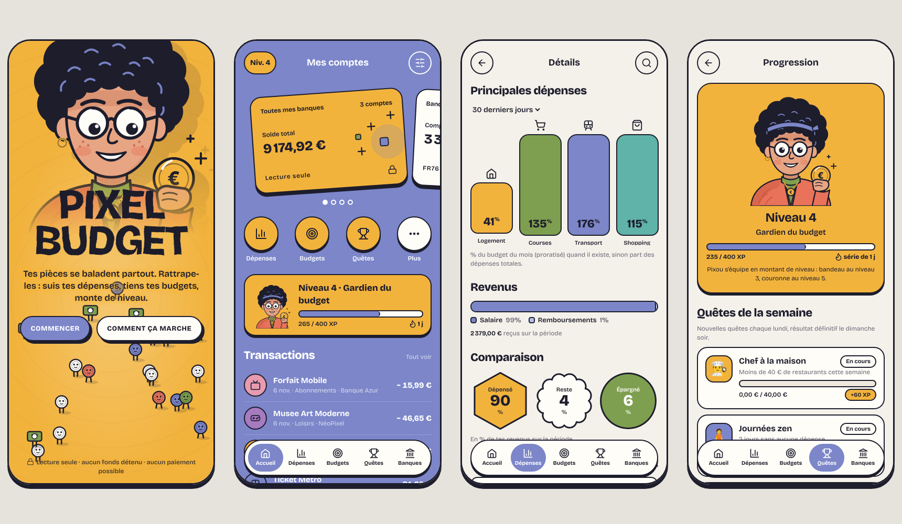

# PixelBudget 🎮💶

Application de gestion d'argent **gamifiée** : l'utilisateur connecte ses
comptes bancaires, suit ses dépenses, fixe des budgets et des objectifs
d'épargne, et gagne de l'XP, des niveaux et des badges en gardant de bonnes
habitudes.



> L'application **ne détient aucun fonds**. Elle lit les comptes en lecture
> seule (agrégation DSP2) et ne peut initier aucun paiement.

## Fonctionnalités du prototype

- **Écran d'accueil animé** : Pixou, la mascotte, suit ton doigt des yeux pendant
  qu'une foule de petites pièces se balade à ses pieds (tape-les pour les rattraper).
- **Agrégation multi-banques** avec parcours de consentement (banques de démo fictives).
- **Accueil** : cartes de comptes en carrousel (solde total + chaque compte),
  raccourcis, carte de progression du joueur, dernières transactions.
- **Détails** : catégorisation automatique, principales dépenses en % du budget,
  répartition des revenus, comparaison dépensé / reste / épargné, liste filtrable.
- **Budgets mensuels** par catégorie et **objectifs d'épargne**.
- **Gamification** :
  - XP et niveaux (avec titres : Apprenti épargnant → Légende de l'épargne) ;
  - 4 **quêtes hebdomadaires** (ex. « moins de 40 € de restaurants ») ;
  - 9 **badges** ; **série** de jours de suivi 🔥 ;
  - détail « d'où vient ton XP ». L'XP est recalculée à partir des données
    réelles : impossible de tricher en modifiant un compteur.

## Lancer

```bash
npm start   # http://localhost:5173
npm test    # tests unitaires (node:test, aucune dépendance)
```

Aucune dépendance à installer (Node ≥ 20).

## Application Android (APK)

L'APK embarque l'application web dans une WebView native : elle fonctionne
hors ligne et garde ses données sur le téléphone. Le bouton retour d'Android et
la couleur de la barre d'état suivent l'écran affiché.

- APK prêt à installer : [`dist/PixelBudget-0.2.0.apk`](dist/PixelBudget-0.2.0.apk)
  (Android 6.0 et plus). Sur le téléphone : autoriser l'installation
  d'applications de sources inconnues, puis ouvrir le fichier.
- Reconstruire : `npm run build:apk` (outils requis listés en tête de
  `android/build-apk.sh` ; pas besoin d'Android Studio ni de Gradle).
- Icônes : `npm run icons:android` (régénère les icônes depuis la mascotte).

> L'APK fourni est signé avec une **clé de test**. Pour le Play Store, créez
> votre propre clé de publication et passez-la au script (`KEYSTORE`,
> `KEY_ALIAS`, `KEYSTORE_PASS`). Le Play Store exige aussi un bundle `.aab` et
> un niveau d'API cible récent : à prévoir avant la publication.

## Structure

```
index.html
src/
  main.js              interface (vues, navigation, actions)
  styles.css
  core/
    providers.js       interface BankProvider + DemoProvider (données fictives)
    analytics.js       catégorisation, agrégats, budgets
    gamification.js    XP, niveaux, quêtes, badges, séries
    dates.js, store.js
  ui/icons.js          icônes (SVG)
  ui/mascot.js         mascotte « Pixou » (SVG, s'équipe selon le niveau)
  ui/hero.js           animation de l'écran d'accueil (foule de pièces, regard)
  fonts/               police Bricolage Grotesque embarquée (SIL OFL)
android/               coquille Android (WebView), ressources et script de build
dist/                  APK généré
tests/core.test.js
docs/ARCHITECTURE.md   réglementation (DSP2/AISP, RGPD) et passage en production
```

Pour brancher de vraies banques, voir [docs/ARCHITECTURE.md](docs/ARCHITECTURE.md).
